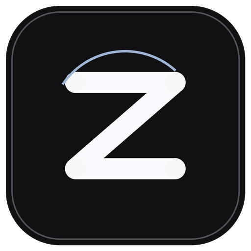

<p align="center">
  
</p>

<h1 align="center">Zenix Music Player</h1>

<p align="center"><strong>Your music. Your own universe.</strong></p>

<p align="center">A personal music space for Windows and Android, with custom sources, a local library, and lyrics.</p>

<p align="center">
  <a href="https://github.com/17hwliao/Zenix/releases/latest"></a>
  <a href="#development"></a>
  <a href="LICENSE"></a>
</p>

<p align="center">
  <a href="#download">Download</a> &nbsp;·&nbsp;
  <a href="#features">Features</a> &nbsp;·&nbsp;
  <a href="#first-listen">First listen</a> &nbsp;·&nbsp;
  <a href="#development">Development</a> &nbsp;·&nbsp;
  <a href="#credits">Credits</a>
</p>

---

Zenix brings your music into a personal space. Browse a sticker collage, orbiting tracks, or a minimal list; manage playlists and appearance from your profile; keep listening with lyrics, music roaming, and local caching.

| Make room for music | Bring your own library | Find the next song |
| :--- | :--- | :--- |
| Focusable stickers, personal cards, custom backgrounds, and three space layouts. | Custom music sources, local audio, playlists, and cached playback. | Recommendations based on local listening habits, with cross-source deduplication and continuous playback. |

## Download

### Version 1.3.0 · build 58

| Platform | Download |
| :--- | :--- |
| **Windows x64** | [Installer · r58](https://github.com/17hwliao/Zenix/releases/download/v1.3.0/Zenix-Setup-1.3.0-r58-x64.exe) |
| **Android** | [APK with the existing release signature · r58](https://github.com/17hwliao/Zenix/releases/download/v1.3.0/Zenix-Android-1.3.0-r58.apk) |
| **Checksums** | [SHA256SUMS · r58](https://github.com/17hwliao/Zenix/releases/download/v1.3.0/SHA256SUMS-1.3.0-r58.txt) |

Maintenance revision **r58** removes the fixed ten-minute update-download cutoff and adds validated resume support. Active transfers continue while making progress; connection and inactivity protection, cancellation, complete-file SHA-256, and installer identity checks remain. Older clients retain their own limits until they successfully install this revision.

Version 1.3.0 adds **multi-track orbit** and **minimal list** layouts alongside the default sticker collage. Rotate the tracks from the center, browse branches independently, adjust card sizes, and use separate play and expand controls. Both platforms retain the existing song, section, and playback flows, plus the companion's fixed music commands, eight outfits, five-line floating lyrics, and clean lyrics mode from version 1.2.0.

The [release notes](docs/releases/v1.3.0-r58.md) describe public version 1.3.0 and internal build 58 on both platforms. Stable and preview metadata point to this release. Existing application identity, update keys, user-data locations, and retained download entry points are unchanged; reinstalling from scratch or clearing data is not required.

<details>
<summary><strong>Recorded review and verification scope</strong></summary>

Revision r58 passed 36 targeted local checks covering progressive downloads, interruption/resume, cancellation, range validation, the existing update pipeline, release identity, and data protection. GitHub regression and Android compilation checks passed. Both packages were verified against their version, build, update configuration and original release identity. No active client data was changed, and no new physical-device installation or complete system-upgrade test is claimed.

See the [maintenance notes](docs/releases/v1.3.0-r58.md). The original r57 [review](docs/review-space-presentation-2026-10-26.md) and [layout design](docs/design/music-space-presentation.md) remain as historical records.

</details>

Windows x64 and Android are the current distribution targets. The iOS project remains in the repository, with distribution paused. Linux and macOS packages are not currently provided.

## Features

| Area | Available functionality |
| :--- | :--- |
| **Music space** | Sticker counts follow the current search or playlist. Browse by dragging, focus a sticker, play or expand through separate controls, and switch to orbit or list layouts. |
| **Personal profile** | Edit your profile card; open likes, favorites, history, playlists, the local library, and settings through surrounding cards; customize backgrounds and covers. |
| **Custom sources** | Import Zenix source packages, folders, compatible `.js` scripts, or HTTP/HTTPS URLs. Preview, enable, reorder, update, and remove sources. |
| **Search and fallback** | A glass search bar appears near the top edge. Mobile results retain the sticker space and focus animation. Playback prefers recently successful sources, then follows the manual order and quality preferences. |
| **Local music** | Import audio files or folders, read metadata, duration, and artwork, and import or export M3U playlists. |
| **Playback and cache** | Queues, previous/next, shuffle, repeat, seeking, volume, and system media keys. Complete cached audio is preferred locally; local tracks work offline. |
| **Collections** | Likes, favorites, deduplicated recent history, and custom playlists stay on the device. Removing a queue entry is separate from deleting a library item. |
| **Music roaming** | Continuous recommendations based on local listening habits, cross-source fingerprint deduplication, replenished candidates, and failure skipping. The recommendation algorithm does not use an external recommendation API. |
| **Lyrics** | Embedded or same-name local lyrics, optional online lyrics from source/catalog adapters, timeline browsing, seeking, and automatic return to the current line. |
| **Desktop lyrics** | A separate transparent five-line window, with two lines before and after the current line, horizontal or vertical layout, adjustable fonts and colors, dragging, and locking. Floating lyric text does not seek playback. |
| **Appearance and sound** | Image or video backgrounds, Lottie startup animation, and three interaction-sound categories with five choices each; sounds can be adjusted or disabled. |

Additional tools include `.zenixlist` playlists, LAN playlist transfer, listening statistics and memory cards, a sleep timer, and desktop widgets. See [music tools](docs/music-tools.md). Mobile gestures, quick saving, cache state, and source management are covered in the [mobile playback guide](docs/mobile-playback-and-gestures.md); page and sticker transition work is recorded in the [performance notes](docs/review-mobile-performance.md).

Zenix currently has no account or login system.

## First listen

1. Choose an image or video background at startup, or skip it and change it later.
2. Edit the central profile card or open player settings through the surrounding cards.
3. Import and enable your own source under **Player settings → Music sources**, or import local audio for offline listening.
4. Move to the top-edge search area, enter a query, and press Enter or the search button. Click a sticker to focus it; use its play button to start the track.
5. Open likes, favorites, history, or a playlist to browse that collection in the music space. Entering the space directly shows recent listening history.
6. Start **Music roaming** to keep discovering tracks. With no history, listen to a song first. Pausing retains the roaming session; playing an ordinary track exits it. [Roaming behavior](docs/music-roaming.md)

The application interface currently uses Chinese labels. The English names above describe their corresponding controls; detailed guides retain the original interface wording.

### Sources and audio quality

Zenix supports its own source protocol and compatible custom `.js` scripts. Import a file, source folder, or HTTP/HTTPS URL, then choose platforms, quality, source order, and update settings.

Playback tries the configured sources and available quality options in sequence, reporting an error if all attempts fail. Updating a script preserves its position. Search, playback, and lyric availability depend on the installed source; finding a song does not guarantee a playable URL.

**Zenix does not bundle source scripts, songs, or the developer's personal configuration.** Sources are installed by the user. Development builds retain optional import entry points; these do not represent preinstalled sources. See [distribution configuration](docs/distribution-config.md).

### Local files, lyrics, and playlists

- Audio formats include MP3, FLAC, M4A, WAV, OGG, Opus, and AAC; playback also depends on the environment's codecs.
- Lyrics can come from embedded metadata or same-name `.lrc`, `.vtt`, `.ttml`, `.qrc`, `.yrc`, and `.krc` files. Timeline and content support follows the current parser implementation.
- Online sources and catalog adapters may supply artwork and lyrics. Missing lyrics produce an empty state.
- Likes, favorites, history, and playlists are local. Queue removal affects the queue; library deletion uses the song-management view. Local M3U playlists can be imported and exported.

### Space and window controls

Browse stickers with the mouse, focus a card, or explicitly expand the player. In the main player, lyrics support browsing and seeking, then return to the current line after inactivity. The playback bar includes seeking, likes, favorites, and playlist actions.

The transparent desktop lyric window supports five lines, horizontal or vertical layout, fonts, colors, preview, a top drag area, and a bottom-right resize handle. Controls collapse when the pointer leaves; locking reduces interference with other applications. The home button recalls the main window. Hover buffers and delayed hiding keep controls available during dragging. The window maintains its topmost order without taking keyboard focus from other apps.

Drag the profile's surrounding cards to rotate them, and use the wheel to scroll the page. The center card supports editing and moving between layers. The upper-right window control or F11 toggles native desktop fullscreen; Esc also exits when no profile panel is open.

### Data, backup, and cache

Settings and the library live in the local application user-data directory. Local songs are primarily file indexes; collections retain track metadata. Audio caching is automatic, without a dedicated manual song-download feature. Clearing the cache does not remove library entries or imported source audio files.

The default cache budget is **1 GiB**, with 512 MiB, 1 GiB, 2 GiB, and 5 GiB options. Older, less recently used entries are evicted when needed; entries unvisited for 30 days may be cleaned. The cache is not a permanent music backup.

Profile details and some appearance preferences use Local Storage. **Data backup** can export selected playlists, collections, profile fields, and supported settings, with a restore preview and undo snapshot. It excludes audio, source credentials, and system permissions. Cloud sync is not available. See [storage and distribution notes](docs/distribution-config.md).

### Updates and earlier versions

Windows and Android verify signed update metadata and package integrity before installation. Internal build numbers distinguish revisions of the same public version. Hiding update reminders does not disable checking or downloading. Android uses installer locations tied to the build and digest; Windows uses the system network/proxy path and shows the installer. [Update and signing guide](docs/automatic-updates.md)

Both platforms can export installed sources as `.zenixsources` packages and import shared files or HTTPS links after confirmation. Private source packages are not bundled. [Source sharing](docs/source-sharing.md) · [Android](docs/android.md) · [iOS](docs/ios.md)

The [original README archive](docs/archive/readme-before-english.zh-CN.md) retains first-release downloads, earlier Android revisions, update incident limits, and their evidence. Some old test-download links were removed in the recorded cleanup; affected clients should refresh metadata before downloading. Older test builds may need one manual same-signature installation. Those limits do not imply that an unverified upgrade path has been repaired. See the [first stable release](docs/releases/v1.0.0.md), [mobile revisions](docs/releases/v1.0.1-mobile-fixes.md), and [baseline review](docs/review-first-stable.md).

## Development

Requires Windows, Node.js 22.12 or later, and npm:

```powershell
npm ci
npm run build
npm start
```

For development:

```powershell
npm run dev
```

Development runs Vite and Electron together. The local production preview uses the result of `npm run build`.

### Windows packages

```powershell
npm run package:win
```

Output goes to `release/`. The electron-builder NSIS installer targets Windows x64; this command disables automatic publication. `npm run package:dir` produces an unpacked app directory. The allowlist in `electron-builder.yml` excludes user data. Application licenses and notices go under `resources/`; Electron and Chromium notices remain at the installation root.

To create a local desktop shortcut:

```powershell
powershell -ExecutionPolicy Bypass -File .\scripts\Create-DesktopShortcut.ps1
```

### Architecture and guides

React, TypeScript, and Vite provide the interface; Electron provides the desktop host. The main process owns files, the library, windows, source requests, and audio caching, exposed through preload APIs. Source scripts run in a separate host, and the application proxies playback requests.

```text
src/              Interface, player state, lyrics, and interactions
electron/         Desktop main process, preload, library, and sources
electron/runtime/ Source host, networking, media proxy, and cache
assets/           Icons, animation resources, and synthesized sounds
scripts/          Local launch helpers and profiling tools
docs/             Protocols, configuration, and engineering notes
licenses/         Original third-party licenses and notices
```

The runtime also uses Framer Motion, lottie-web, Paper Shaders, Lucide, music-metadata, HTMLAudioElement, and the Media Session API. IPC, Fetch, Range requests, JSON, Local Storage, and disk caching connect the layers. Exact dependency versions are recorded in the lockfile and [technical-stack guide](docs/technical-stack.md).

| Read more | Guide |
| :--- | :--- |
| Custom source design | [Integration design](docs/custom-source-design.md) · [Zenix source protocol](docs/zenix-source-protocol.md) |
| Discovery and deduplication | [Local music roaming](docs/music-roaming.md) |
| UI, performance, and memory | [Technical stack](docs/technical-stack.md) · [Performance architecture](docs/performance-architecture.md) · [Regression and memory record](docs/regression-memory-2026-10-03.md) |
| Packaging and import | [Distribution configuration](docs/distribution-config.md) · [Source sharing](docs/source-sharing.md) |
| Attribution | [Third-party notices](THIRD_PARTY_NOTICES.md) · [Original licenses](licenses/) |

Only user-installed, enabled sources participate in search and playback. Repository import entry points do not embed the external scripts themselves. Supporting guides are currently primarily in Chinese.

## Credits

Zenix uses third-party frameworks and components and was developed with AI assistance. Thanks to the authors and maintainers whose work supports its interface, source compatibility, animation, and audio handling. Detailed provenance and license texts remain in [THIRD_PARTY_NOTICES.md](THIRD_PARTY_NOTICES.md).

### Design and implementation references

| Project | Reference scope |
| :--- | :--- |
| [Folia Major](https://github.com/chthollyphile/folia-major) | Window layout, glass controls, sticker presentation, focus and playback interactions, and motion. |
| [LX Music Desktop](https://github.com/lyswhut/lx-music-desktop) | Custom-source protocols, script interfaces, and catalog adapter code and implementation ideas. |

The profile page also integrates card-layout references supplied by the project owner.

### Runtime components

| Project | Role | License |
| :--- | :--- | :--- |
| [Electron](https://github.com/electron/electron) | Desktop windows, processes, IPC, and system APIs. | MIT, with independent notices for bundled components. |
| [React](https://github.com/react/react) | React / React DOM rendering and components. | MIT |
| [Motion](https://github.com/motiondivision/motion) | Page and control animation through Framer Motion. | MIT |
| [lottie-web](https://github.com/airbnb/lottie-web) | Startup animation playback. | MIT |
| [Paper Shaders](https://github.com/paper-design/shaders) | MeshGradient, Dithering, and React shader components. | Apache-2.0 |
| [Lucide](https://github.com/lucide-icons/lucide) | Window, playback, lyric, and management icons. | ISC |
| [music-metadata](https://github.com/Borewit/music-metadata) | Audio metadata, embedded artwork, and lyrics. | MIT |

Development and build tools include [Vite](https://github.com/vitejs/vite), [vite-plugin-react](https://github.com/vitejs/vite-plugin-react), [TypeScript](https://github.com/microsoft/TypeScript), [DefinitelyTyped](https://github.com/DefinitelyTyped/DefinitelyTyped), [concurrently](https://github.com/open-cli-tools/concurrently), [cross-env](https://github.com/kentcdodds/cross-env), and [wait-on](https://github.com/jeffbski/wait-on). Development dependencies are recorded separately from shipped runtime components.

### Sources, services, and assets

External source scripts remain the work of their respective authors, with their own licenses and service terms. Development import entry points were collected for local use and compatibility work; they are not bundled scripts or a guarantee of continuing availability. See the [source and script notices](THIRD_PARTY_NOTICES.md).

Catalog adapters access services including Kuwo, Kugou, NetEase Cloud Music, QQ Music, and Migu for search, artwork, or lyrics. These integrations do not imply participation, endorsement, or content redistribution rights from those services. The [third-party notices](THIRD_PARTY_NOTICES.md) describe their scope.

Startup uses Lottie animation data. The icon was drawn with [Pillow](https://github.com/python-pillow/Pillow); interaction sounds were synthesized with Python's standard library. User photos, videos, songs, and covers remain the property of their providers or rights holders.

## Contributing and verification

`npm test` covers playback, stickers, lyrics, cache, network permissions, encrypted migration, and player-bar interactions. It requires Node.js, Electron, and JDK. Windows checks include system encryption and isolated full-page Electron tests without reading personal configuration. Push, PR, and release workflows include test gates. See the [security and regression record](docs/security-repair.md) for results and environment limits.

New compatible scripts allow HTTPS by default. HTTP and public-domain restrictions can be configured per source. Windows source configuration and Android private state use system encryption with atomic migration; decryption failures retain the original file and stop writes. Runtime script content is outside this at-rest protection, and encrypted files cannot simply be copied between devices for recovery.

Bug reports should include the app and OS versions, reproduction steps, and observed behavior. For source problems, include the script version and failure stage. Remove credentials, contact information, and personal paths from shared logs or screenshots. Contributions should explain their scope and verification, retain applicable upstream notices, identify new third-party material, and follow the project's license for original code.

## Content and services

Zenix provides source integration and playback functionality, without an account system. External services, platform APIs, and media are independent of the project. Use content you are authorized to access and follow the relevant service terms. The software license does not grant rights to songs, lyrics, covers, or other online content.

The software is supplied under its license without a suitability or availability guarantee. This explanation adds no restrictions beyond the GPL.

## License

Copyright (C) 2026 17hwliao.

**Original Zenix code that the developer is entitled to license uses GNU GPL version 3 only (`GPL-3.0-only`).** See [LICENSE](LICENSE) for the complete terms, including applicable notice and corresponding-source requirements when distributing it.

Third-party components, references, external scripts, and assets retain their own copyrights and licenses. Folia Major uses AGPL-3.0; LX Music Desktop uses Apache-2.0. Their reference and use scope is recorded in [Credits](#credits), [THIRD_PARTY_NOTICES.md](THIRD_PARTY_NOTICES.md), and [licenses/](licenses/).
